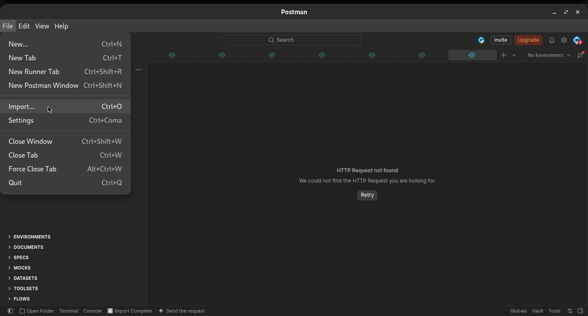
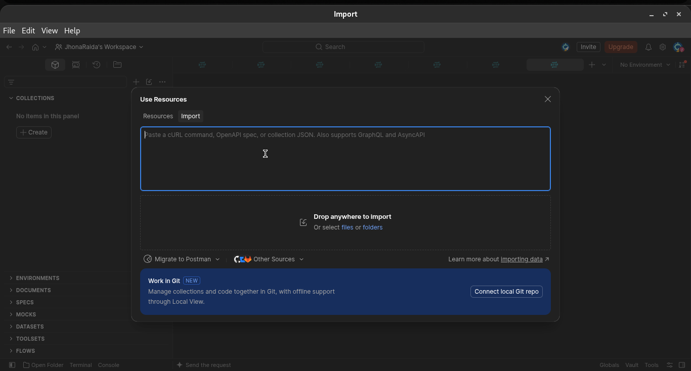
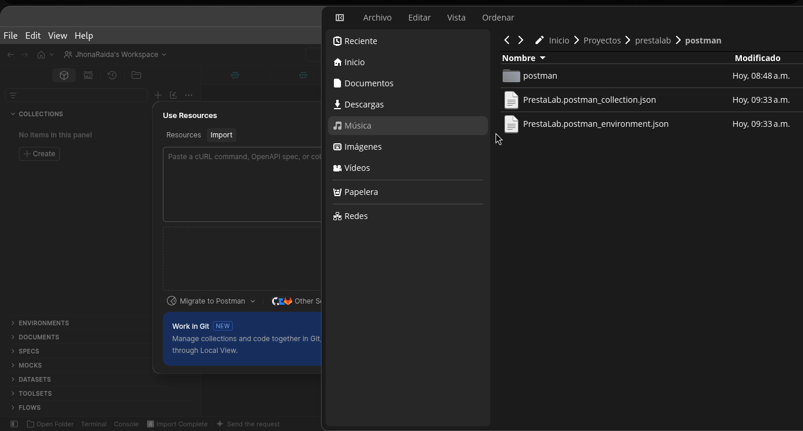
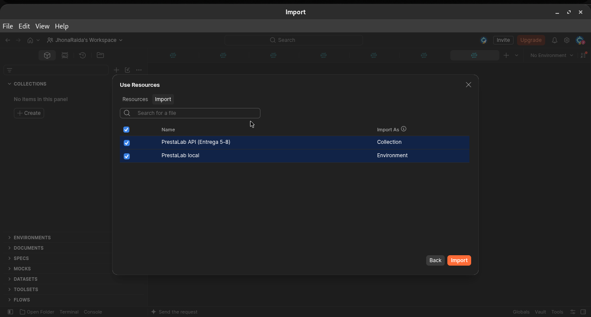
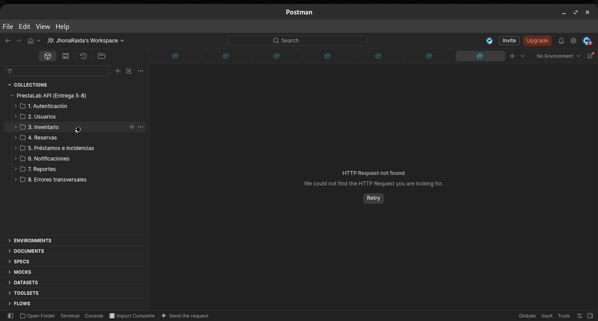

# PrestaLab

Sistema de reserva y control de préstamo de equipo y espacios de laboratorio, construido con Arquitectura Orientada a Servicios: un **API Gateway** y **cinco servicios** (Usuarios, Inventario, Reservas, Notificaciones y Reportes) con **PostgreSQL**.

Proyecto Integrador de Arquitectura Orientada a Servicios · Ingeniería en Software · Politécnica Santa Rosa
**Equipo "Tranquilo nos la navegamos":** Jhonatan Uriel Morales Badillo, José Vidal López Salazar, David Sosa Gómez, Alejandro Ramírez Contreras
**Docente:** Ing. Luis Leonardo Mendoza Reséndiz

Esta guía explica, paso a paso, cómo **instalar, ejecutar y probar** el proyecto. La documentación técnica está en [`docs/`](docs/) y los documentos y evidencias de cada entrega en [`entregas/`](entregas/).

> **¿Dónde se escriben los comandos?**
> - **Windows:** en **PowerShell**. Búscalo en el menú Inicio escribiendo "PowerShell". Todos los comandos de esta guía funcionan ahí.
> - **Mac:** en la app **Terminal**.
> - **Linux:** en la terminal. Si un comando `docker` responde `permission denied`, escribe `sudo` antes (por ejemplo `sudo docker compose up`).

---

## Paso 1. Instalar lo necesario

Se necesitan tres programas. Todos son gratuitos y se descargan de su página oficial; elige la versión para tu sistema (Windows, Mac o Linux) e instálalo como cualquier programa. **Docker** ya trae Node.js y PostgreSQL, así que no hay que instalarlos aparte.

| Programa | Para qué sirve | Página oficial |
|---|---|---|
| **Git** | Descargar el proyecto | <https://git-scm.com/downloads> |
| **Docker Desktop** | Ejecutar el sistema (servicios y base de datos) | <https://www.docker.com/products/docker-desktop/> |
| **Postman** | Probar la API | <https://www.postman.com/downloads/> |

En el instalador de **Git** se pueden dejar todas las opciones como vienen (solo **Next** hasta **Install**).

Después de instalar **Docker Desktop**, **ábrelo** y déjalo abierto mientras uses el proyecto.

**En Windows**, al instalar Docker Desktop:

1. Deja marcada la opción **Use WSL 2** (viene marcada por defecto). WSL 2 es lo que Docker necesita para funcionar en Windows.
2. Al terminar pide **reiniciar la computadora**: hazlo.
3. Abre **Docker Desktop** y espera a que abajo a la izquierda diga **Engine running** (en verde). Puede pedir aceptar los términos o crear una cuenta; la cuenta es opcional (**Skip**).
4. Si aparece un error de **WSL** o de **virtualización**:
   - Si dice que falta WSL o que hay que actualizarlo, sigue la guía oficial de Microsoft: <https://learn.microsoft.com/es-mx/windows/wsl/install> y reinicia.
   - Si dice que la virtualización está desactivada, hay que activarla en el BIOS de la computadora (la opción se llama *Virtualization Technology*, *Intel VT-x* o *AMD-V*, según la marca).

Para comprobar que Docker funciona:

```bash
docker run hello-world
```

Debe aparecer el mensaje **"Hello from Docker!"**.

## Paso 2. Descargar el proyecto

En PowerShell o en la terminal:

```bash
git clone https://github.com/JhonaRaida/prestalab.git
cd prestalab
```

Esto crea la carpeta `prestalab` (en Windows queda en `C:\Users\<tu usuario>\prestalab`) y entra en ella. **Todos los comandos siguientes se escriben dentro de esa carpeta.** Si cierras PowerShell, al volver a abrirlo escribe `cd prestalab` antes de seguir.

## Paso 3. Crear el archivo de configuración

El proyecto trae un ejemplo llamado `.env.example`. Hay que copiarlo con el nombre `.env`:

```bash
cp .env.example .env
```

Ábrelo para editarlo:

- **Windows:** `notepad .env` (se abre en el Bloc de notas).
- **Mac / Linux:** con cualquier editor de texto, por ejemplo `nano .env`.

Cambia el valor de `JWT_SECRET` y de `SERVICE_TOKEN` por cualquier texto largo, por ejemplo `miClaveSuperLarga123abc456def`. Son las claves con las que el sistema firma los inicios de sesión. Guarda el archivo y ciérralo.

El archivo `.env` se queda solo en tu computadora.

## Paso 4. Levantar el sistema

Dentro de la carpeta `prestalab`:

```bash
docker compose up --build
```

La primera vez tarda unos minutos, porque Docker descarga lo necesario. Van a aparecer muchas líneas; el sistema está listo cuando aparece:

```
[gateway] escuchando en el puerto 8080
```

**Deja esa terminal abierta:** si la cierras, el sistema se apaga. Las siguientes veces basta con `docker compose up` (sin `--build`).

Al arrancar se crean solas las 4 bases de datos, sus tablas y los datos de prueba.

> Puede aparecer el aviso `database "prestalab" does not exist`. No es una falla: es la revisión automática de Docker y se puede ignorar.

## Paso 5. Comprobar que funciona

Abre en el navegador:

- <http://localhost:8080/health> → el Gateway y los 5 servicios deben decir `"ok"`.
- <http://localhost:8080/docs> → documentación interactiva de la API (Swagger).

## Paso 6. Probar la API con Postman

### 6.1 Abrir Postman

Si todavía no lo instalas, descárgalo de su página oficial: <https://www.postman.com/downloads/>.

Al abrirlo pide iniciar sesión: se puede crear una cuenta gratis. Si pregunta para qué lo vas a usar, cualquier opción sirve (por ejemplo **Test or debug an API**).

### 6.2 Importar la colección

La colección son todas las peticiones del proyecto ya preparadas. Está en la carpeta `postman/` del proyecto.

**1.** En el menú **File** elige **Import…**



**2.** En la ventana que se abre, haz clic en **files**.



> **Importante:** elige **files**, no **folders** ni **Connect local Git repo**. Si abres la carpeta como carpeta local, Postman la convierte a su propio formato, borra los archivos `.json` del proyecto y las peticiones no abren.

**3.** Entra a la carpeta `prestalab/postman/` y selecciona los **dos archivos** (con `Ctrl` presionado): `PrestaLab.postman_collection.json` y `PrestaLab.postman_environment.json`. Luego **Abrir**.



**4.** Postman muestra lo que va a importar: la colección **PrestaLab API (Entrega 5-8)** y el entorno **PrestaLab local**. Deja las dos marcadas y haz clic en **Import**.



**5.** A la izquierda, en **Collections** (el ícono del cubito), aparece la colección con sus 8 carpetas.



### 6.3 Enviar una petición

1. Arriba a la derecha, donde dice **No Environment**, elige **PrestaLab local**.
2. Abre una carpeta, por ejemplo **3. Inventario**, y haz clic en una petición, por ejemplo **Listar y filtrar recursos**.
3. Haz clic en el botón azul **Send**.
4. Abajo aparece la respuesta: el código (por ejemplo **200 OK** o **201 Created**) y los datos en JSON.

**No hace falta iniciar sesión antes.** Cada petición usa la cuenta que le corresponde (alumno, encargado, administrador…) y, si todavía no hay sesión o ya venció (dura 1 hora), la colección inicia sesión sola.

Para correr las 61 peticiones de una vez: clic derecho en la colección → **Run collection** → **Run**.

> Si aparece una barra morada con sugerencias de la IA de Postman (**Fix**, **Diagnose**), haz clic en **Decline**: si se acepta, Postman modifica la petición.

### Peticiones para revisar el CRUD (carpeta 3. Inventario)

| Qué se prueba | Petición | Resultado esperado |
|---|---|---|
| Crear un registro | **Crear recurso (encargado)** | 201 Created |
| Consultar varios | **Listar y filtrar recursos** | 200 OK |
| Consultar uno | **Consultar recurso** | 200 OK |
| Modificar | **Reemplazar recurso (PUT)** | 200 OK |
| Error de validación | **Crear recurso sin campos → 400** | 400 Bad Request |
| Recurso inexistente | **Recurso inexistente → 404** | 404 Not Found |
| Eliminar | **5. Préstamos e incidencias → Dar de baja el recurso (DELETE)** | 204 No Content |

Conviene seguir este orden: "Consultar", "Reemplazar" y "Dar de baja" usan el recurso creado en "Crear recurso".

## Paso 7. Apagar el sistema

En la terminal donde corre, presiona `Ctrl + C`, o en otra terminal:

```bash
docker compose down
```

Los datos se conservan para la siguiente vez. Para borrarlos y empezar de cero: `docker compose down -v`.

---

## Cuentas de prueba

Contraseña de todas: **`Prestalab123`**

| Correo | Rol |
|---|---|
| `admin@prestalab.mx` | administrador |
| `encargado1@prestalab.mx` | encargado (Laboratorios de Cómputo y de Redes) |
| `encargado2@prestalab.mx` | encargado (Laboratorio de Electrónica) |
| `docente@prestalab.mx` | docente |
| `alumno1@prestalab.mx`, `alumno2@prestalab.mx` | alumno |

## Otras formas de probar

### Desde la terminal, sin abrir Postman (Newman)

Con el sistema corriendo, en otra terminal dentro de la carpeta del proyecto:

```bash
npx -p newman -p newman-reporter-htmlextra newman run postman/PrestaLab.postman_collection.json -e postman/PrestaLab.postman_environment.json -r cli,htmlextra --reporter-htmlextra-export reporte-postman.html
```

Necesita Node.js, que se descarga de su página oficial: <https://nodejs.org>. Muestra el resultado de cada petición y genera `reporte-postman.html` para verlo en el navegador.

### Evidencias de los CRUD (Entrega 5)

Con el sistema corriendo y Node.js instalado:

```bash
npm run evidencias
```

Crea, consulta, modifica y da de baja un recurso y una reserva, y provoca errores 400, 404 y 401. Cada petición queda guardada con su respuesta en `entregas/entrega-5/evidencias/evidencias-crud.json`.

### Con Swagger, desde el navegador

1. Entra a <http://localhost:8080/docs>.
2. Abre `POST /sesiones`, haz clic en **Try it out**, escribe `{"correo":"alumno1@prestalab.mx","contrasena":"Prestalab123"}` y **Execute**. Copia el `tokenAcceso` de la respuesta.
3. Haz clic en **Authorize** (arriba a la derecha), pega el token y ya puedes probar cualquier endpoint.

### Ver la base de datos

En otra terminal, dentro de la carpeta del proyecto:

```bash
docker compose exec postgres psql -U prestalab -d postgres -c "\l"        # las 4 bases
docker compose exec postgres psql -U prestalab -d reservas_db -c "\dt"    # tablas de una base
docker compose cp db/verificar.sql postgres:/tmp/verificar.sql
docker compose exec postgres psql -U prestalab -d postgres -f /tmp/verificar.sql   # consultas y pruebas
```

### Sin Docker

Necesitas **Node.js 20 o superior** (<https://nodejs.org>) y **PostgreSQL 14 o superior** (<https://www.postgresql.org/download/>) instalados y corriendo.

```bash
npm install
cp .env.example .env     # edita DB_USER, DB_PASSWORD, JWT_SECRET y SERVICE_TOKEN
npm run db:crear         # crea las 4 bases
npm start                # arranca el Gateway y los 5 servicios
```

Pruebas automáticas: `npm test` (necesitan PostgreSQL y las bases creadas, pero no que el sistema esté corriendo).

## Problemas comunes

| Mensaje | Qué hacer |
|---|---|
| `Cannot connect to the Docker daemon` o `error during connect` | Docker Desktop está cerrado: ábrelo y espera a que diga **Engine running** (en Linux, usa `sudo`). |
| `docker` no se reconoce como comando (Windows) | Docker Desktop no está instalado o falta reiniciar la computadora después de instalarlo. |
| Error de WSL o de virtualización al abrir Docker Desktop (Windows) | Revisa el punto 4 de la instalación de Docker en el Paso 1. |
| `permission denied` en Linux | Te faltó `sudo` antes de `docker`. |
| `service "postgres" is not running` | El sistema está apagado: corre `docker compose up` primero. |
| `database "prestalab" does not exist` | No es una falla: es la revisión automática de Docker. Se puede ignorar. |
| Puerto 8080 ocupado | Cambia `PORT_GATEWAY` en `.env` o cierra el programa que lo usa. |
| Cambié `DB_USER`/`DB_PASSWORD` y Docker sigue fallando | El volumen conserva la configuración vieja: `docker compose down -v` y vuelve a levantar. |
| Postman: las peticiones no abren o desaparecieron los `.json` | Se abrió la carpeta como carpeta local. Recupera los archivos con `git restore postman/` e impórtalos con **File → Import → files**. || 401 `TOKEN_INVALIDO` | El token dura 1 hora. La colección de Postman inicia sesión sola; en Swagger, vuelve a iniciar sesión. |
| 429 `DEMASIADAS_PETICIONES` | Es el límite del Gateway (a propósito). Espera un minuto. |

## Más información

| Documento | Contenido |
|---|---|
| [`docs/arquitectura.md`](docs/arquitectura.md) | Servicios, estructura del código, decisiones de diseño, limitaciones y pruebas avanzadas |
| [`docs/cambios.md`](docs/cambios.md) | Cambios respecto al diseño de entregas anteriores |
| [`docs/openapi.yaml`](docs/openapi.yaml) | Contrato de la API (también en <http://localhost:8080/docs>) |
| [`entregas/`](entregas/) | Documentos, reportes y evidencias de cada entrega |
