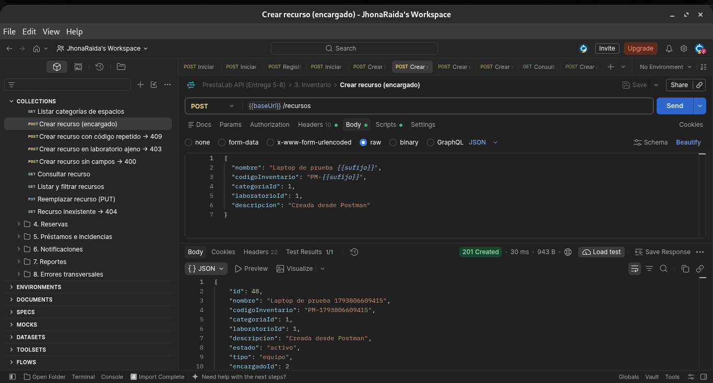
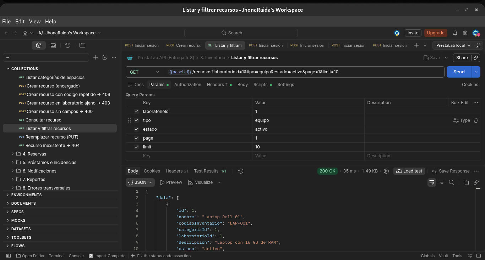
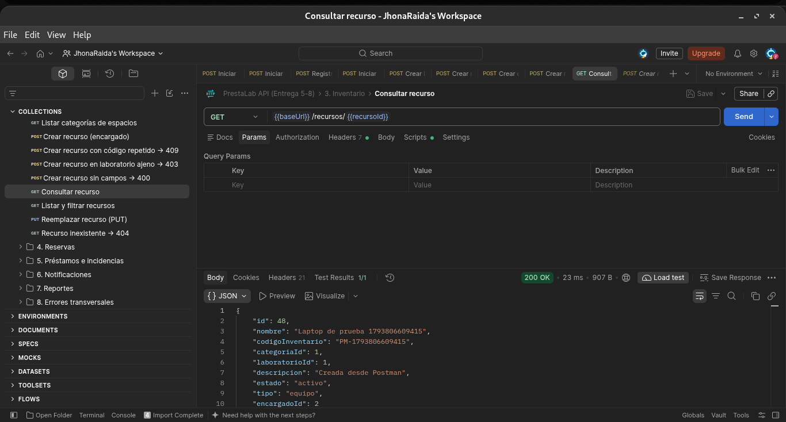
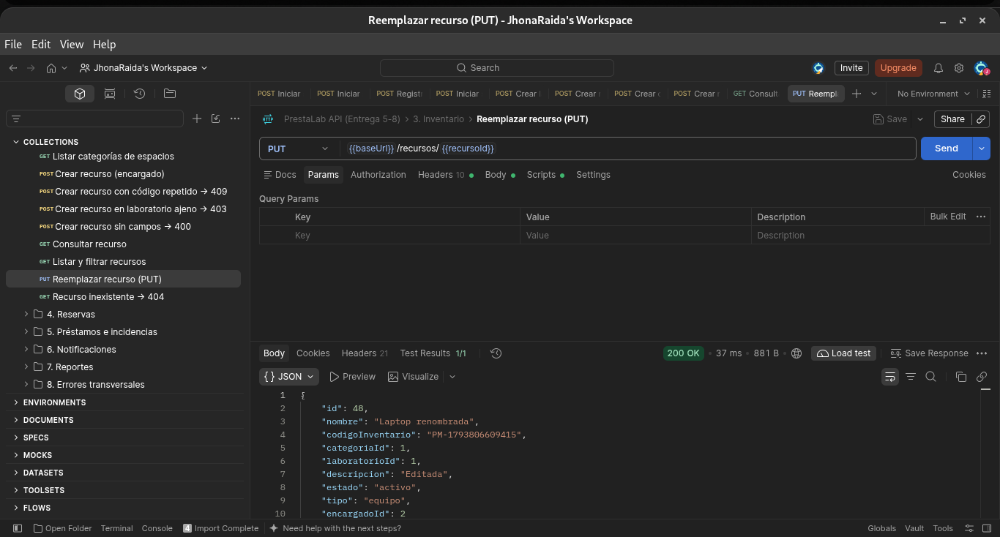
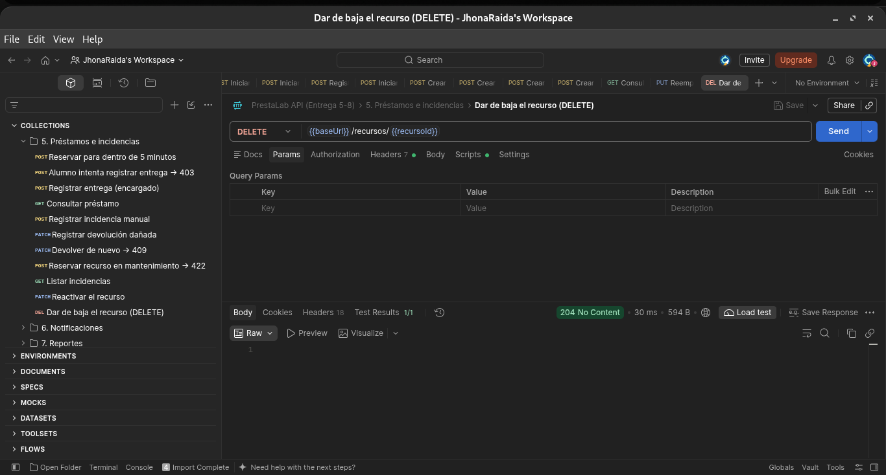
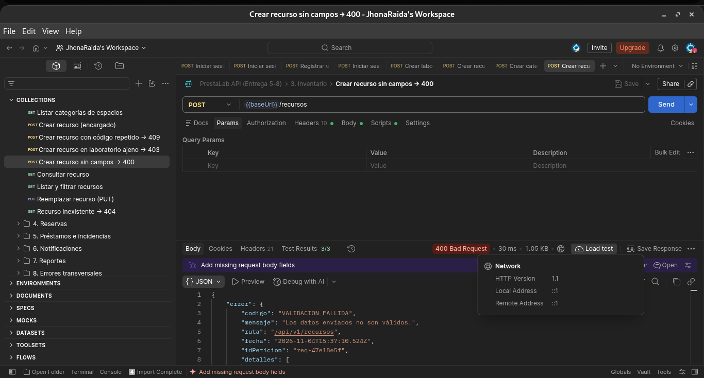
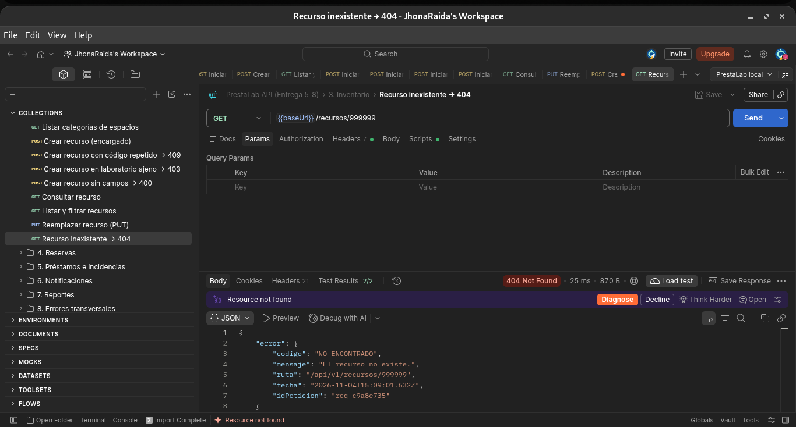

# Entrega 5 — MVP Backend I

**Proyecto:** PrestaLab · Sistema de reserva y control de préstamo de equipo y espacios de laboratorio
**Materia:** Arquitectura Orientada a Servicios · Ing. Luis Leonardo Mendoza Reséndiz
**Equipo "Tranquilo nos la navegamos":** Jhonatan Uriel Morales Badillo, José Vidal López Salazar, David Sosa Gómez, Alejandro Ramírez Contreras
**Repositorio:** <https://github.com/JhonaRaida/prestalab> · tag `entrega-5`

## Reporte breve

| | |
|---|---|
| **Entrega** | 5 — MVP Backend I (primera implementación funcional) |
| **Objetivo de la semana** | Demostrar que la arquitectura diseñada funciona como software: backend configurado, conectado a PostgreSQL, con CRUD, validaciones y manejo de errores. |
| **Qué se implementó** | Backend en Node.js + Express con un API Gateway y 5 servicios, cada uno organizado en rutas, controladores, servicios y acceso a datos. CRUD completo de **Recursos** y **Reservas** contra PostgreSQL, validaciones (400), manejo de 404 y 500, colección de Postman con 61 peticiones y README de ejecución. |
| **Qué cambió respecto a la entrega anterior** | La arquitectura y el modelo de datos de la Entrega 4 no cambiaron. La colección de Postman ahora inicia sesión sola cuando falta el token o ya venció, y la documentación se reorganizó: el `README.md` quedó solo con instalación y ejecución, y la parte técnica pasó a `docs/`. Detalle en [`docs/cambios.md`](../../docs/cambios.md). |
| **Problemas encontrados** | Al abrir la carpeta `postman/` como carpeta local, Postman convirtió la colección a su propio formato, borró los archivos `.json` del repositorio y no dejaba abrir las peticiones. |
| **Cómo se resolvieron** | Se recuperaron los archivos con `git restore`, la colección se importa como archivos (**File → Import**) y también se puede ejecutar con **Newman**, el ejecutor de Postman para terminal. Además, al probar petición por petición salían errores 401 porque cada una usa el token de una cuenta distinta; se resolvió con el inicio de sesión automático de la colección. |
| **Pendientes para la semana 6** | Documentar con evidencias la autenticación con JWT, los roles, las reglas de negocio y la operación que involucra varios servicios (reserva → préstamo → incidencia). |

## Implementación mínima

| Requisito | Dónde está |
|---|---|
| Proyecto backend configurado | [`package.json`](../../package.json), [`docker-compose.yml`](../../docker-compose.yml), [`Dockerfile`](../../Dockerfile) |
| Rutas, controladores, servicios y acceso a datos | Cada servicio en `services/<servicio>/src/` tiene `routes.js` → `controller.js` → `service.js` → `repository.js`. Ejemplo: [`services/inventario/src/`](../../services/inventario/src/) |
| Variables de entorno | [`.env.example`](../../.env.example) (el `.env` real no se sube) |
| Conexión con la base de datos | [`shared/db.js`](../../shared/db.js) → PostgreSQL 16, una base por servicio |
| CRUD de 2 recursos principales | **Recursos** (`/recursos`) y **Reservas** (`/reservas`) |
| Validaciones básicas | Esquemas Zod en cada `controller.js` y [`shared/validar.js`](../../shared/validar.js) → responde **400** con el detalle de cada campo |
| Manejo de 404 y 500 | [`shared/errors.js`](../../shared/errors.js): 404 para ruta o registro inexistente; 500 con mensaje genérico, sin mostrar detalles internos |
| Colección de Postman | [`postman/PrestaLab.postman_collection.json`](../../postman/PrestaLab.postman_collection.json) y su entorno |
| README con instalación y ejecución | [`README.md`](../../README.md) |

La organización del código y las decisiones de diseño están en [`docs/arquitectura.md`](../../docs/arquitectura.md).

## Criterios mínimos de aceptación

| Criterio | Cómo se cumple |
|---|---|
| El proyecto puede ejecutarse siguiendo el README | El [`README.md`](../../README.md) explica requisitos, instalación, ejecución con Docker, cómo comprobar que funciona y cómo probar la API. |
| Los endpoints demostrados funcionan contra datos persistentes | Las evidencias se hicieron contra PostgreSQL: el recurso creado en la captura 1 es el mismo que se consulta, modifica y elimina en las capturas 3 a 5. |
| No todo el código está en un único archivo | Gateway y 5 servicios separados; cada servicio dividido en rutas, controlador, servicio y repositorio. Ver [`docs/arquitectura.md`](../../docs/arquitectura.md). |
| Los cambios respecto al diseño anterior están documentados | [`docs/cambios.md`](../../docs/cambios.md). |

## Evidencias

Capturas tomadas en Postman el 4 de noviembre de 2026, con el sistema levantado en Docker y los datos guardados en PostgreSQL. Se usó el CRUD de **Recursos** (equipo y espacios de laboratorio) con la cuenta de encargado. Todas las capturas están en la carpeta [`evidencias/`](evidencias/).

| # | Evidencia que se pide | Petición | Resultado |
|---|---|---|---|
| 1 | Crear un registro | `POST /recursos` | 201 Created |
| 2 | Consultar varios registros | `GET /recursos?laboratorioId=1&tipo=equipo&estado=activo` | 200 OK |
| 3 | Consultar un registro | `GET /recursos/48` | 200 OK |
| 4 | Modificar un registro | `PUT /recursos/48` | 200 OK |
| 5 | Eliminar un registro | `DELETE /recursos/48` | 204 No Content |
| 6 | Error de validación | `POST /recursos` con `{ "nombre": "x" }` | 400 Bad Request |
| 7 | Recurso inexistente | `GET /recursos/999999` | 404 Not Found |

### 1. Crear un registro

El encargado registra una laptop nueva. Arriba se ve el cuerpo enviado y abajo la respuesta **201 Created** con el recurso guardado (id 48, estado `activo`).



### 2. Consultar varios registros

Lista de recursos del laboratorio 1, filtrada por tipo `equipo` y estado `activo`, con paginación (`page=1`, `limit=10`). Responde **200 OK** con la lista en `data`.



### 3. Consultar un registro

Consulta del recurso creado en la captura 1 por su id. Responde **200 OK** con sus datos.



### 4. Modificar un registro

Se reemplazan los datos del recurso 48 con `PUT`. Responde **200 OK**: el nombre cambió a `Laptop renombrada` y la descripción a `Editada`.



### 5. Eliminar un registro

`DELETE` del recurso 48. Responde **204 No Content**: la operación se hizo y no hay contenido que devolver.

Un recurso no se borra físicamente porque tiene historial de reservas y préstamos: el `DELETE` lo marca como **dado de baja** (`"estado": "baja"`) y deja de aparecer como disponible.



### 6. Error de validación

Se intenta crear un recurso solo con `{ "nombre": "x" }`. Responde **400 Bad Request** con el código `VALIDACION_FALLIDA` y, en `detalles`, cada campo que falta o es incorrecto.



### 7. Recurso inexistente

Consulta de un id que no existe. Responde **404 Not Found** con el código `NO_ENCONTRADO` y el mensaje "El recurso no existe."



### Ejecución completa de la colección

[`evidencias/reporte-postman.html`](evidencias/reporte-postman.html): resultado de ejecutar las 61 peticiones de la colección con Newman (91 verificaciones, 0 fallas). Descárgalo y ábrelo en el navegador para ver cada petición con su respuesta.

## Evidencias complementarias

Además de las capturas de Postman, se ejecutó la misma secuencia para el **segundo CRUD (Reservas)** y para el **error 500**. Cada petición quedó guardada con su respuesta real en [`evidencias/evidencias-crud.json`](evidencias/evidencias-crud.json). Se puede repetir en la defensa con el sistema corriendo:

```bash
npm run evidencias
```

### CRUD de Reservas

Con la cuenta `alumno1`. En Reservas, **eliminar es cancelar**: la reserva cambia a `"estado": "cancelada"` y libera el horario, pero se conserva en el historial (misma regla de baja lógica que en Recursos, Entrega 3 E-23).

| # | Evidencia que se pide | Petición | Resultado |
|---|---|---|---|
| 8 | Crear un registro | `POST /reservas` con `{ "recursoId", "inicio", "fin" }` | 201 Created |
| 9 | Consultar varios registros | `GET /reservas?page=1&limit=3` | 200 OK |
| 10 | Consultar un registro | `GET /reservas/11` | 200 OK |
| 11 | Modificar un registro (horario) | `PATCH /reservas/11` con `{ "inicio", "fin" }` | 200 OK |
| 12 | Eliminar un registro (cancelar) | `PATCH /reservas/11` con `{"estado":"cancelada"}` | 200 OK |
| 13 | Comprobar la cancelación | `GET /reservas/11` | 200 OK |
| 14 | Error de validación (falta `fin`) | `POST /reservas` sin `fin` | 400 Bad Request |
| 15 | Registro inexistente | `GET /reservas/999999` | 404 Not Found |

Respuesta de la consulta 13, después de cancelar:

```json
{
  "id": 11,
  "usuarioId": 4,
  "recursoId": 1,
  "inicio": "2026-11-08T16:00:00.000Z",
  "fin": "2026-11-08T18:00:00.000Z",
  "estado": "cancelada",
  "creadaEn": "2026-11-04T16:03:05.872Z"
}
```

### Error 500

Se detuvo PostgreSQL unos segundos y se consultó un recurso. El cliente recibe un mensaje genérico, sin detalles internos:

```json
{
  "error": {
    "codigo": "ERROR_INTERNO",
    "mensaje": "Ocurrió un error inesperado. Intenta de nuevo más tarde.",
    "ruta": "/api/v1/recursos/1",
    "fecha": "2026-11-04T16:03:30.604Z",
    "idPeticion": "req-f73ce06c"
  }
}
```

El error real (`connect ECONNREFUSED 127.0.0.1:5432`) solo quedó en el log del servidor, con el mismo `idPeticion`. Al encender PostgreSQL de nuevo, la misma consulta respondió 200 sin reiniciar los servicios. La prueba `un error inesperado no revela detalles internos` de [`test/unit.test.js`](../../test/unit.test.js) comprueba lo mismo.

### Los datos quedan en la base

Consulta directa a `reservas_db` después de la secuencia:

```
reservas_db=> SELECT id, usuario_id, recurso_id, inicio, fin, estado FROM reservas WHERE id = 11;
 id | usuario_id | recurso_id |         inicio         |          fin           |  estado   
----+------------+------------+------------------------+------------------------+-----------
 11 |          4 |          1 | 2026-11-08 16:00:00+00 | 2026-11-08 18:00:00+00 | cancelada
(1 row)
```

## Documento de la entrega

[`Entrega5_PrestaLab.pdf`](Entrega5_PrestaLab.pdf) (y su versión [`.docx`](Entrega5_PrestaLab.docx)) reúne este reporte en el formato de las entregas anteriores, con la bitácora de cambios completa.
