# Entrega 6 — MVP Backend II

**Proyecto:** PrestaLab · Sistema de reserva y control de préstamo de equipo y espacios de laboratorio  
**Materia:** Arquitectura Orientada a Servicios · Ing. Luis Leonardo Mendoza Reséndiz  
**Equipo "Tranquilo nos la navegamos":** Jhonatan Uriel Morales Badillo, José Vidal López Salazar, David Sosa Gómez, Alejandro Ramírez Contreras  
**Repositorio:** <https://github.com/JhonaRaida/prestalab> · tag `entrega-6`

## Reporte breve

| | |
|---|---|
| **Entrega** | 6 — MVP Backend II (segunda implementación funcional y refinamiento) |
| **Objetivo de la semana** | Consolidar la autenticación basada en tokens JWT, control de acceso por roles (RBAC), implementación de las reglas de negocio en la gestión de préstamos/incidencias y validación con pruebas de integración. |
| **Qué se implementó** | Flujo completo de **Reservas → Préstamos → Incidencias** en el servicio de Reservas y Préstamos, conectado con Inventario, Usuarios y Notificaciones. Autenticación con JWT (1 h) validada en el API Gateway y control de acceso por rol (alumno, docente, encargado, administrador). Reglas de negocio en el backend (traslape, límite por rol, recurso activo, sanciones, plazos, tolerancia). Devolución transaccional entre servicios, filtros y paginación, colección de Postman con casos positivos y negativos y 57 pruebas automáticas. |
| **Qué cambió respecto a la entrega anterior** | La arquitectura no cambió. En la Entrega 5 se demostraron los CRUD de Recursos y Reservas; en esta se documentan con evidencias la autenticación, los roles, las reglas de negocio y la operación que involucra varios servicios. Se agregó el apartado de reglas de negocio en [`Entrega6_PrestaLab.pdf`](Entrega6_PrestaLab.pdf). |
| **Problemas encontrados** | Dos usuarios podían reservar el mismo recurso al mismo tiempo; el límite de reservas se podía saltar con peticiones simultáneas; una devolución podía quedar a medias si Inventario o Usuarios fallaban. |
| **Cómo se resolvieron** | Restricción `EXCLUDE USING gist` en `reservas` (la base rechaza el traslape y la API responde 409); `pg_advisory_xact_lock` dentro de la transacción de creación; la devolución se hace en una transacción ([`shared/db.js`](../../shared/db.js)) que se revierte y responde 503 si otro servicio no contesta. |
| **Pendientes para la siguiente etapa** | Entrega 7: plan y evidencia de pruebas, checklist de seguridad, registro de defectos corregidos y prueba de carga documentada. |

## Implementación mínima

| Requisito | Dónde está |
|---|---|
| Autenticación JWT y roles | [`shared/auth.js`](../../shared/auth.js) (`exigirRol`, `autenticado`) y validación del token en el Gateway ([`gateway/src/`](../../gateway/src/)) |
| Rutas, controladores, servicios y acceso a datos | Cada servicio en `services/<servicio>/src/` (`routes.js` → `controller.js` → `service.js` → `repository.js`). Préstamos e incidencias están en [`services/reservas/src/`](../../services/reservas/src/) |
| Reglas de negocio y validaciones | Esquemas Zod en cada `controller.js`; reglas en [`services/reservas/src/service.js`](../../services/reservas/src/service.js); valores en [`shared/config.js`](../../shared/config.js) |
| Operación que involucra varios servicios | Devolución (`PATCH /prestamos/{id}`): Reservas crea la incidencia, Inventario pone el recurso en mantenimiento y Usuarios aplica la sanción si hubo retraso |
| Transacciones y consistencia | [`shared/db.js`](../../shared/db.js) (`transaccion`): si Inventario o Usuarios fallan se revierte todo (503) |
| Filtros, búsqueda y paginación | `GET /reservas?estado=&page=&limit=`, `GET /recursos?laboratorioId=&tipo=&estado=`, `GET /incidencias` |
| Manejo de errores consistente | [`shared/errors.js`](../../shared/errors.js): 400, 401, 403, 404, 409, 422, 429, 500, 503 con `codigo`, `mensaje`, `ruta`, `fecha` e `idPeticion` |
| Colección de Postman actualizada | [`postman/PrestaLab.postman_collection.json`](../../postman/PrestaLab.postman_collection.json) con inicio de sesión automático |
| Documento de reglas de negocio | Sección 2 de [`Entrega6_PrestaLab.pdf`](Entrega6_PrestaLab.pdf) (RN-01 a RN-16) |

## Criterios mínimos de aceptación

| Criterio | Cómo se cumple |
|---|---|
| Un usuario sin permisos no puede ejecutar operaciones protegidas | Sin token responde **401 `TOKEN_INVALIDO`** (captura 9); con un rol que no corresponde responde **403 `PERMISO_INSUFICIENTE`** (capturas 4 y 11). |
| La lógica importante no depende del cliente | Las reglas se aplican en los servicios y en la base de datos: aunque el cliente mande la petición, el backend la rechaza (capturas 2 y 7). |
| Los errores regresan respuestas entendibles | Todas las respuestas de error traen un `codigo` y un `mensaje` en español. |
| Existe un flujo que conecta varias partes del sistema | Reserva → entrega → devolución dañada → recurso en mantenimiento → incidencia (capturas 1 a 8): Reservas, Inventario, Usuarios y Notificaciones. |

## Evidencias

Capturas tomadas en Postman el 11 de noviembre de 2026, con el sistema levantado en Docker y los datos guardados en PostgreSQL. Las capturas 1 a 8 siguen el flujo completo; las 9 a 11 muestran autenticación y autorización. Todas están en la carpeta [`evidencias/`](evidencias/).

| # | Evidencia | Petición | Resultado |
|---|---|---|---|
| 1 | Crear una reserva | `POST /reservas` | 201 Created |
| 2 | Reservar el mismo horario | `POST /reservas` | 409 `RESERVA_TRASLAPADA` |
| 3 | Historial con filtros y paginación | `GET /reservas?estado=confirmada&page=1&limit=10` | 200 OK |
| 4 | Alumno intenta registrar la entrega | `POST /prestamos` con token de alumno | 403 `PERMISO_INSUFICIENTE` |
| 5 | Registrar la entrega (encargado) | `POST /prestamos` | 201 Created |
| 6 | Registrar devolución dañada | `PATCH /prestamos/42` | 200 OK |
| 7 | Reservar el recurso en mantenimiento | `POST /reservas` | 422 `RECURSO_NO_RESERVABLE` |
| 8 | Listar incidencias | `GET /incidencias` | 200 OK |
| 9 | Petición sin token | sin encabezado `Authorization` | 401 `TOKEN_INVALIDO` |
| 10 | Credenciales incorrectas | `POST /sesiones` | 401 `CREDENCIALES_INVALIDAS` |
| 11 | Alumno intenta subirse el rol | `PATCH /usuarios/48` | 403 `PERMISO_INSUFICIENTE` |

### 1. Crear una reserva

Un alumno reserva el recurso 49. Reservas comprueba que el recurso esté activo (Inventario), que el usuario no tenga sanción (Usuarios), el límite de su rol y que no haya traslape. Responde **201** con la reserva 54 en estado `confirmada` y se genera la notificación de confirmación.

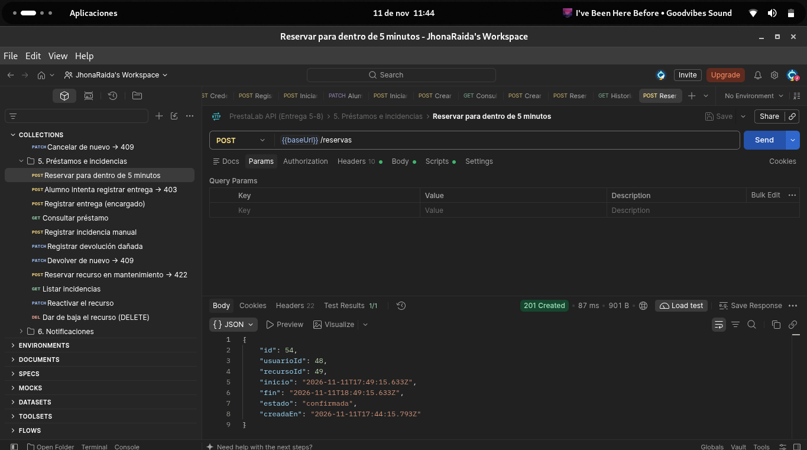

### 2. Reservar el mismo horario (RN-04)

La restricción de la base de datos impide el traslape y la API responde **409** con `RESERVA_TRASLAPADA`: "El recurso ya está reservado en ese horario."

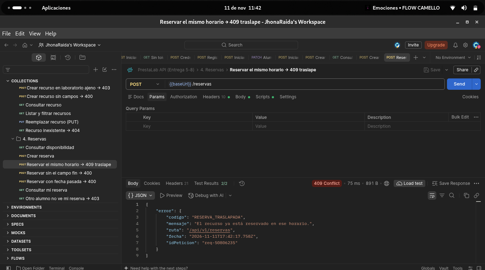

### 3. Historial con filtros y paginación

Historial de reservas filtrado por estado `confirmada` y paginado. Cada usuario solo ve sus propias reservas.

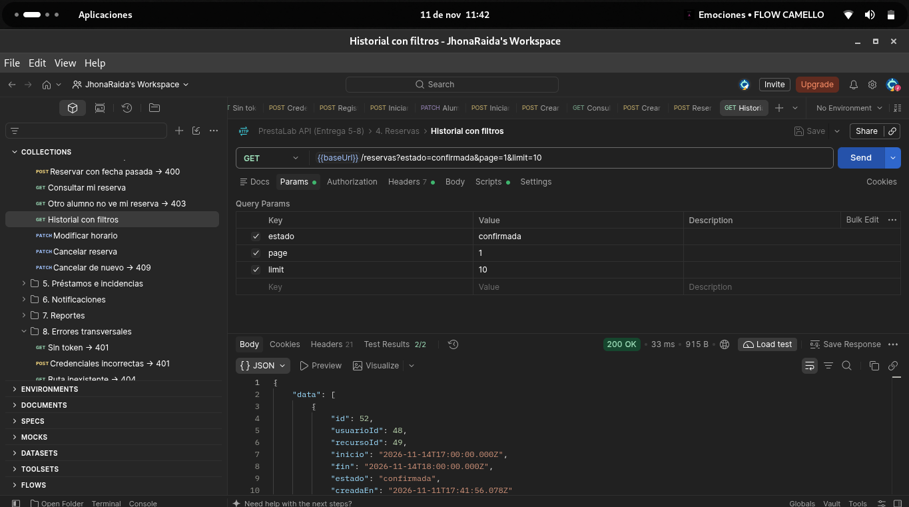

### 4. Alumno intenta registrar la entrega (RN-02)

Registrar la entrega es exclusivo del encargado o el administrador. Con el token de un alumno responde **403** `PERMISO_INSUFICIENTE`: "Tu rol no permite realizar esta operación."

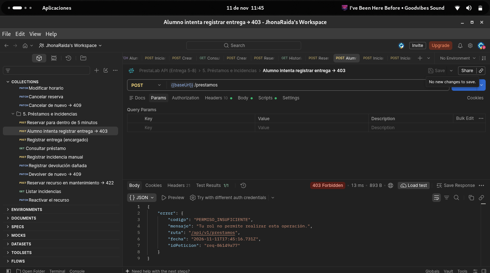

### 5. Registrar la entrega (encargado)

El encargado registra la entrega de la reserva 54 dentro de la ventana de tolerancia. Responde **201** con el préstamo 42; la reserva pasa a `en_curso`.

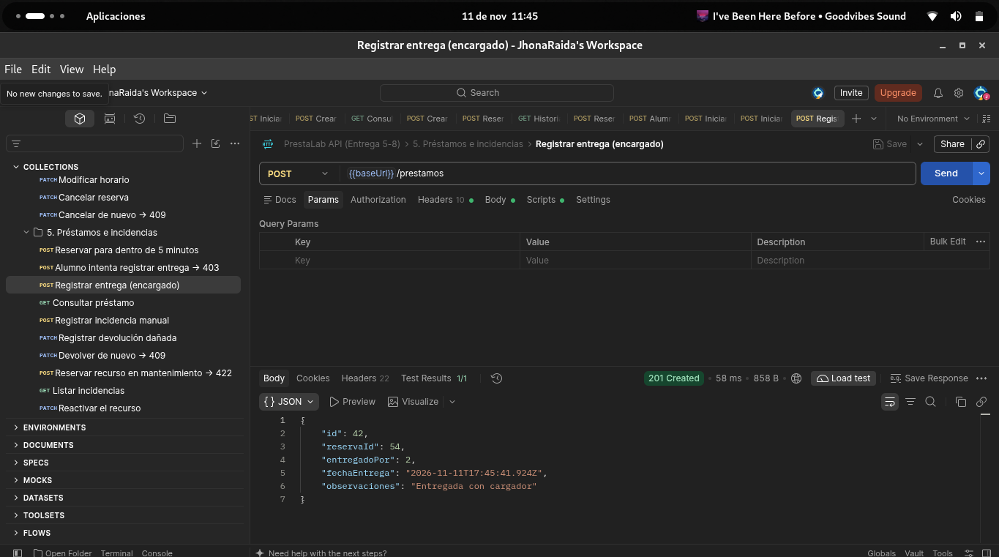

### 6. Registrar devolución dañada (RN-11)

Devolución con `"estadoDevolucion": "danado"` y la observación "Pantalla con rayones". En una sola transacción se cierra el préstamo, se crea la incidencia de daño y Inventario pone el recurso en mantenimiento. Responde **200 OK**.

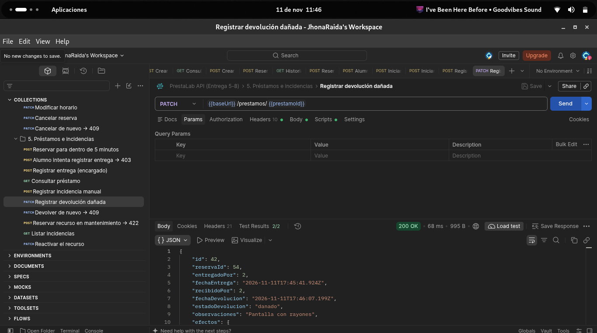

### 7. Reservar el recurso en mantenimiento (RN-06)

Después de la devolución, el recurso ya no se puede reservar: **422** `RECURSO_NO_RESERVABLE`. Comprueba que el cambio llegó a Inventario.

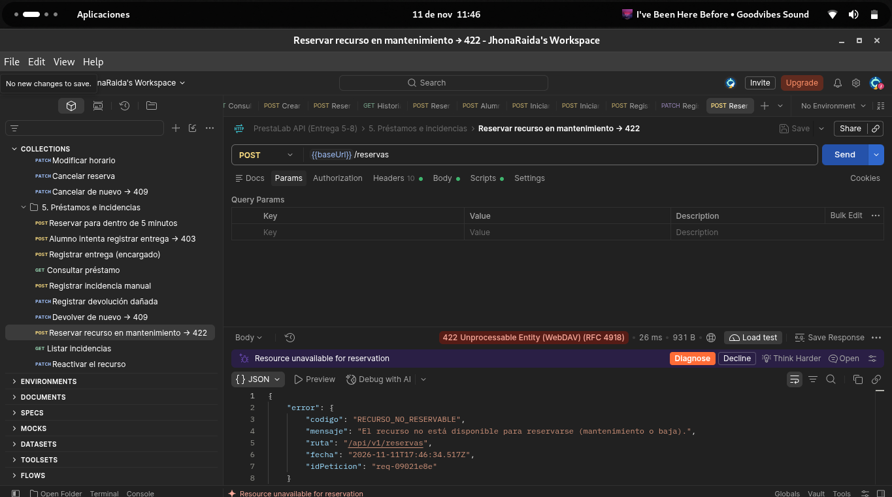

### 8. Listar incidencias

El encargado consulta las incidencias y aparece la incidencia 41 de tipo `dano`, creada automáticamente por la devolución.

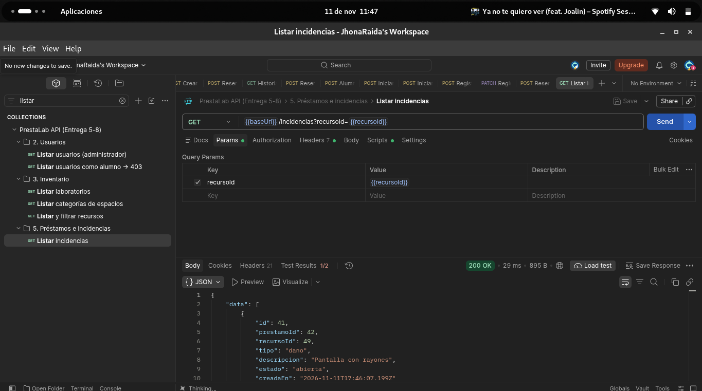

### 9. Petición sin token (RN-01)

El Gateway rechaza cualquier ruta protegida sin un JWT válido: **401** `TOKEN_INVALIDO`.

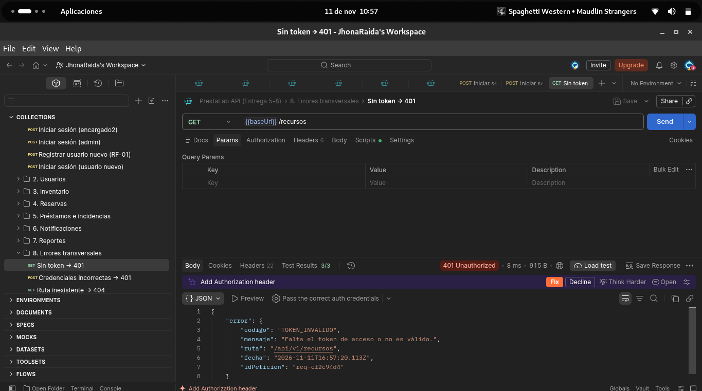

### 10. Credenciales incorrectas

El inicio de sesión responde **401** `CREDENCIALES_INVALIDAS` sin indicar si falló el correo o la contraseña.

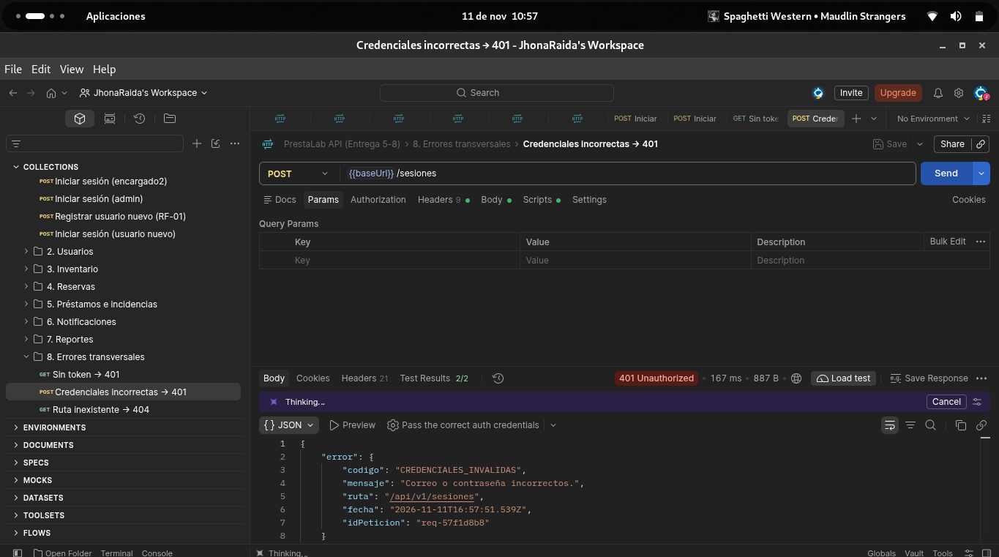

### 11. Alumno intenta subirse el rol (RN-02)

Solo un administrador puede cambiar el rol o el estado de una cuenta: **403** `PERMISO_INSUFICIENTE`.

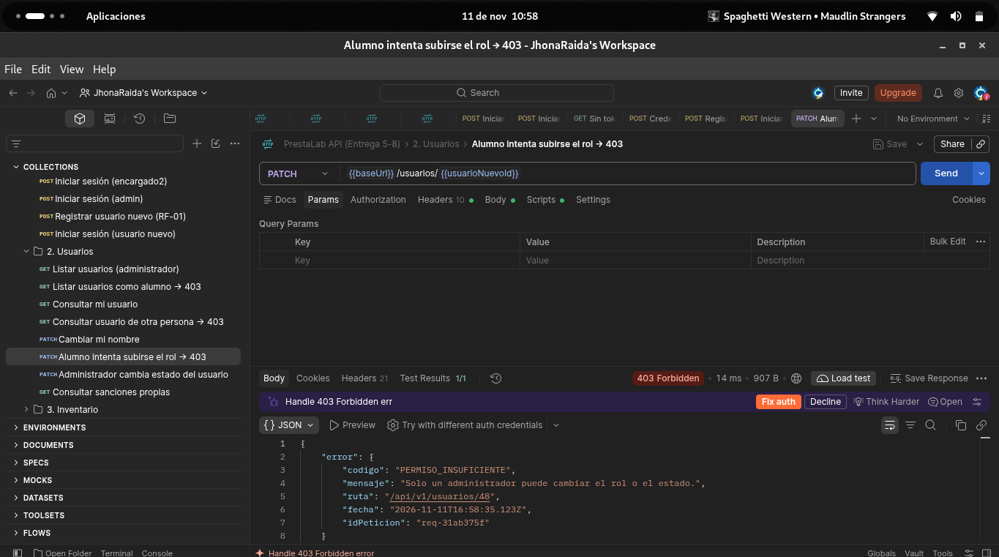

## Documento de la entrega

[`Entrega6_PrestaLab.pdf`](Entrega6_PrestaLab.pdf) (y su versión [`.docx`](Entrega6_PrestaLab.docx)) incluye el reporte de la semana, las reglas de negocio implementadas (RN-01 a RN-16), el flujo completo, los criterios de aceptación y las evidencias.
